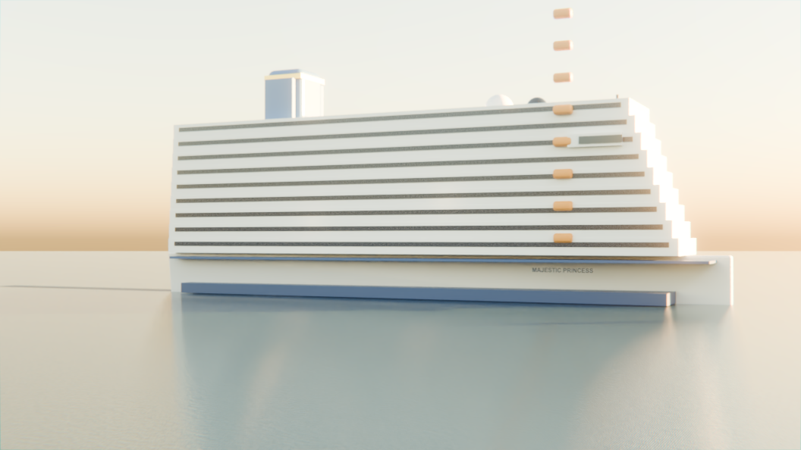

# Majestic Princess at dawn — a procedural cruise scene for XO Tours #7622

A cinematic 3D render for the XO Tours **2027-03-29 盛世公主號郵輪 · 愛爾蘭與英倫 11 天**
cruise (tour 7622): the Majestic Princess on a calm sea at dawn off a British/Irish
headland, a lighthouse on the shore. Everything here is generated by one Python
script in Blender 4.5 — all geometry, every shader (node trees written in code, no
texture files), the lighting, the camera and the compositor grade. No GPU, no
image-generated textures, no add-ons.



## Rendering on GitHub Actions

`.github/workflows/render.yml` renders in the cloud so no workstation has to stay busy:

- every push to `main` renders a half-res preview (smoke test, artifact `preview`)
- **Run workflow** (workflow_dispatch) renders the 1080p still and the 96-frame
  fly-through; the frames are split across N parallel jobs (default 24 × 4 frames),
  stitched with ffmpeg, and the MP4 + PNG are attached to a release tagged `run-<number>`.

Blender 4.5.4 LTS is downloaded from blender.org on first use and cached. Inputs:
`mode` (preview / still / anim / all), `res` (%), `samples_still`, `samples_anim`,
`chunks`.

Environment overrides the script understands: `SHIP_ROOT`, `SHIP_RES`,
`SHIP_SAMPLES`, `SHIP_FRAMES=a-b`. Debug toggles: `SHIP_NOCOMP` (skip the compositor
grade), `SHIP_VOL` (add a world haze volume — off by default; see Lessons).

## Run locally

```
"C:/Program Files/Blender Foundation/Blender 4.5/blender.exe" -b -P build_ship.py -- preview 01
"C:/Program Files/Blender Foundation/Blender 4.5/blender.exe" -b -P build_ship.py -- final 01
"C:/Program Files/Blender Foundation/Blender 4.5/blender.exe" -b -P build_ship.py -- anim 01
```

| mode    | output                                  | settings                          |
|---------|-----------------------------------------|-----------------------------------|
| preview | renders/preview_NN.png                  | 960×540, 64 spp, denoised         |
| final   | renders/final_NN.png + ship.blend       | 1920×1080, 320 spp, denoised      |
| anim    | renders/flythrough_NN_0001-0096.mp4     | 960×540, 40 spp, 96 frames, 24fps |

A quick cheap check: `SHIP_RES=40 SHIP_SAMPLES=24 blender -b -P build_ship.py -- preview t`.

## What is in the scene

- A calm dawn sea (procedural wave + noise bump, glossy water) with the ship's reflection
- The Majestic Princess: a tapered white hull with a navy waterline band and the ship's
  name, nine tiered white passenger decks each with a lit cabin-window row (a Brick
  texture gated by noise so only some cabins are lit at dawn)
- A deep-blue Princess-style funnel with a gold band, a bridge with glass, a radar mast
  with a red nav light, a row of orange lifeboats along the promenade (Array modifier),
  pool-deck domes
- A green/rock headland and a banded lighthouse with a glowing lantern on the far shore
- A low warm Nishita dawn sun, a cool sky fill so the shadow side is not black, and warm
  point lights so the lit decks spill onto the water
- Cycles CPU + OpenImageDenoise, AgX medium-high contrast, compositor bloom / grade / vignette

## Lessons

- **No world volume in a big exterior.** A world Volume Scatter fills the whole 3000-unit
  scene; with `volume_bounces = 0` it extinguishes the sun (an infinite path from the sky)
  and the sky background, turning the entire frame black even at a tiny density. Aerial
  depth comes from the Nishita sky's own atmosphere instead. (`SHIP_VOL` re-enables it only
  for a contained test.)
- Light the camera-facing side. A low sun placed behind the ship backlights it, so the
  visible faces go to shadow and only the top edges catch light (a venetian-blind look).
  The key sun is matched to the sky's sun and set on the camera's side.
- Writing this script through a Bash heredoc fails with ENAMETOOLONG on Windows; use a file write.
